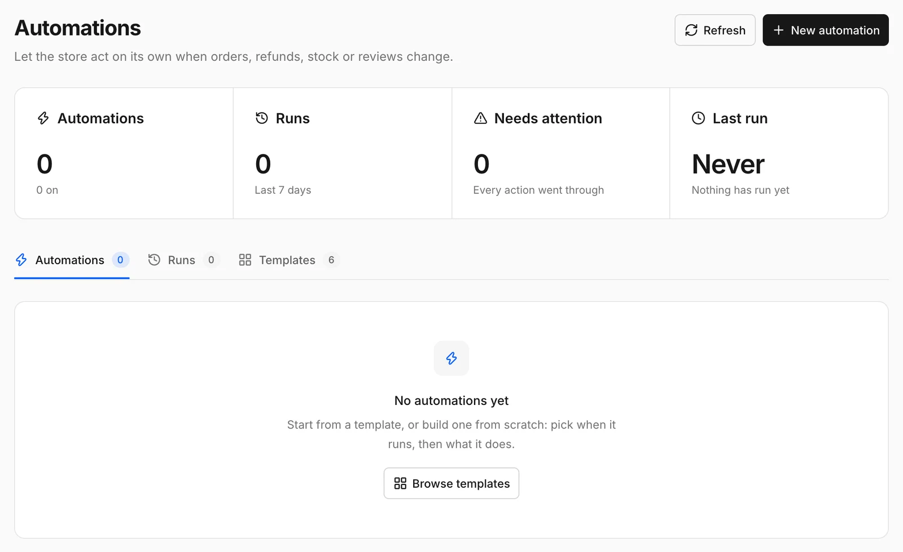
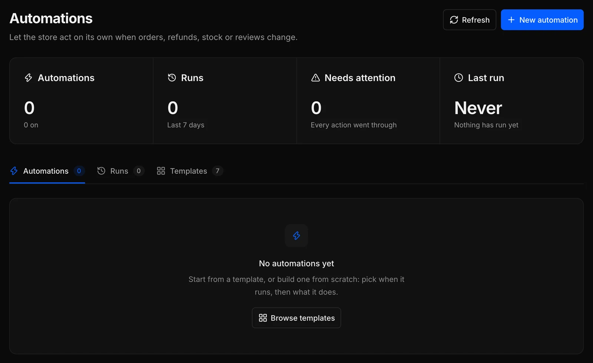

<Frame caption="Automations dashboard with template and creation controls (sample store).">
  
  
</Frame>

Open **Automations** → **Automations**. Select **New automation**, or use **Browse templates** to start from a template.

## Choose a trigger and action

| Trigger | When it runs |
| --- | --- |
| **Order paid** | The buyer pays for an order. |
| **Order refunded** | An order is refunded. |
| **Product sells out** | A product's stock reaches zero. |
| **Review posted** | A buyer posts a review. |
| **Every day** | Once a day. |

Available actions include **Send a Discord message**, **Email me**, **Send the buyer a coupon**, **Block the buyer**, and **Call a webhook**.

Save the automation and turn it on. Select **Run test** to try it without waiting for a live event.

For a stock alert, choose **Product sells out**, then choose **Email me**. Use **Run test** and check the run result before relying on the alert.

## Check results

Open **Automations** → **Runs** to see the **Result** and **Details** for each run. **Needs attention** counts runs with failed actions.
