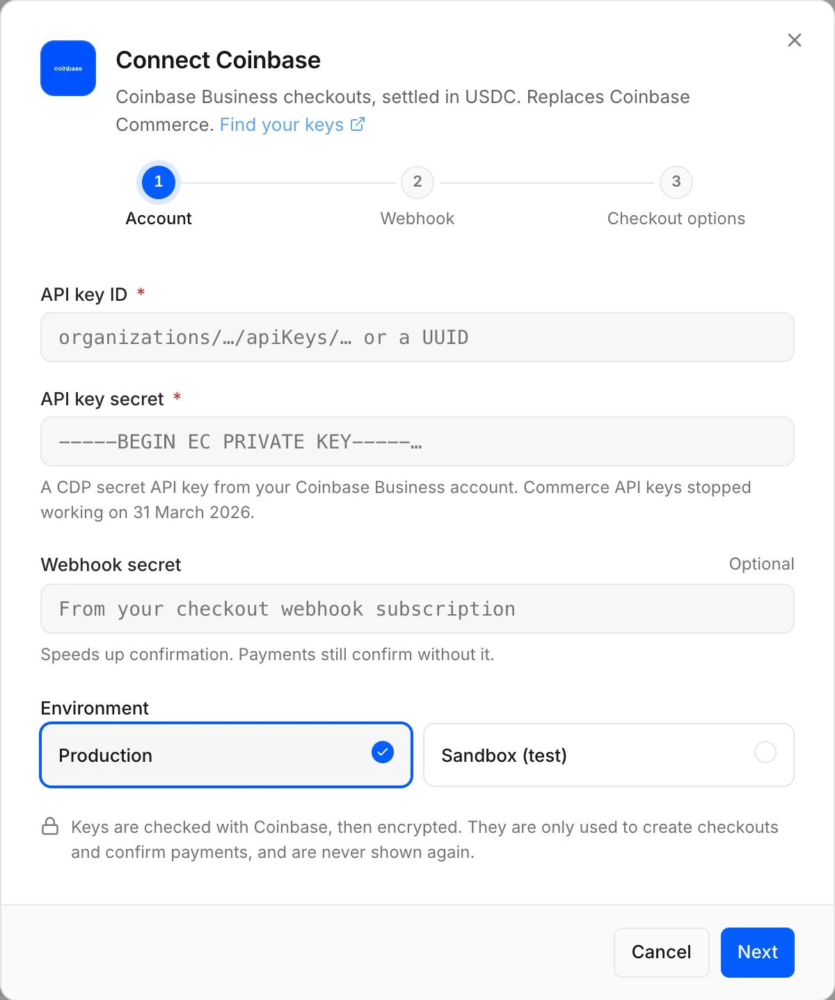
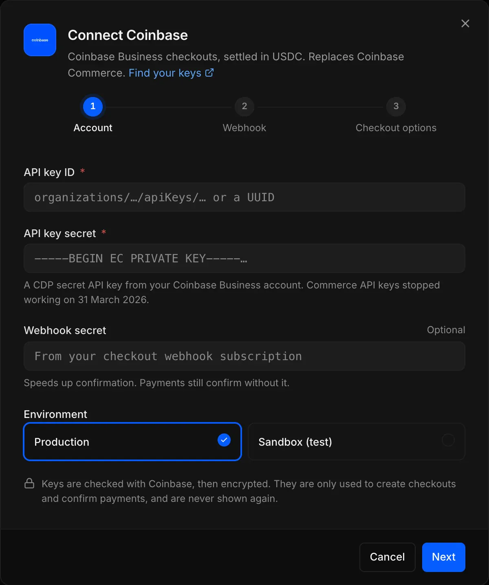

<Frame caption="Coinbase connection dialog (sample store).">
  
  
</Frame>

## Set it up

<Steps>
  <Step title="Use Coinbase Business">
    Coinbase Commerce closed on 31 March 2026, and its API keys no longer work. Payments now go through a Coinbase Business account, available to businesses in the United States and Singapore.
  </Step>
  <Step title="Create a secret API key">
    In the Coinbase Developer Platform, create a secret API key for your Coinbase Business account. Copy the key ID and the private key; the key file shows both.
  </Step>
  <Step title="Connect in the dashboard">
    Open Payments → Payment setup → Cryptocurrency. Choose Coinbase, paste the key ID and private key, and select Connect.
  </Step>
  <Step title="Add a webhook (optional)">
    With the CDP CLI, create a webhook subscription for checkout.payment.success, checkout.payment.failed and checkout.payment.expired that targets the webhook URL from the Connect dialog. Paste the secret it returns.
  </Step>
</Steps>

## Settlement

Checkouts are priced in your store currency and settle in <Icon src="/images/brands/usdc.svg" size={18} /> USDC on Base. Without a webhook, orders still confirm when the buyer returns or within a few minutes.

## If something does not work

<Note title="What to check">
  If Connect says the key was rejected, check that it is a secret API key from Coinbase Business, not an old Commerce key. Paste the whole private key, including the BEGIN and END lines.
</Note>

Still stuck? [Contact support](https://docs.paysum.io/support) with the store, the page, and any order or request reference.

## Next steps

<CardGroup cols={2}>
  <Card title="Crypto payments and wallets" href="https://docs.paysum.io/crypto-payments" icon="Wallet">
    Understand wallet balances, blockchain confirmation, and crypto withdrawals.
  </Card>
  <Card title="Payment methods" href="https://docs.paysum.io/payments" icon="CreditCard">
    Connect the accounts and wallets buyers use to pay your store.
  </Card>
  <Card title="Orders and invoices" href="https://docs.paysum.io/orders" icon="FileText">
    Find a transaction, inspect its status, and troubleshoot payment or delivery.
  </Card>
</CardGroup>
