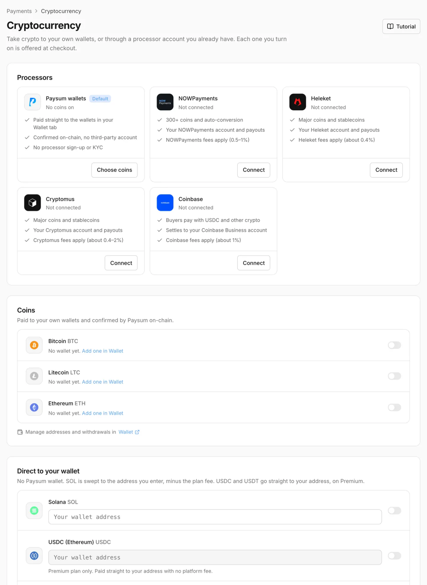
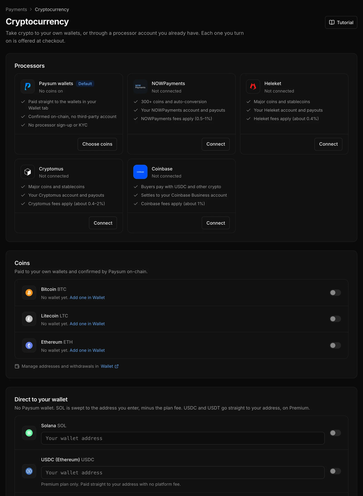

<Frame caption="Crypto options in Payment setup (sample store).">
  
  
</Frame>

## Set it up

<Icon src="/images/brands/bitcoin.svg" size={20} /> Bitcoin · <Icon src="/images/brands/ltc.svg" size={20} /> Litecoin · <Icon src="/images/brands/eth.svg" size={20} /> Ethereum

<Icon src="/images/brands/sol.svg" size={20} /> Solana · <Icon src="/images/brands/usdc.svg" size={20} /> USDC on Ethereum · <Icon src="/images/brands/usdt.svg" size={20} /> USDT on Ethereum

PaySum Premium is required for direct USDC and USDT payments. For third-party providers, see [Payment methods](/payments#crypto-providers).

<Steps>
  <Step title="Configure supported coins">
    Open the payment method settings and enable the coins you intend to accept.
  </Step>
  <Step title="Inspect the wallet">
    Open Payments → Wallet and choose the matching currency. Keep the coin and destination network aligned.
  </Step>
  <Step title="Check an order payment">
    Use the amount and address shown by the actual payment page. Wait for the required confirmation instead of assuming a submitted transaction is complete.
  </Step>
  <Step title="Review withdrawals">
    Open the withdrawal settings and wallet history before sending funds. Verify the destination and network carefully.
  </Step>
</Steps>

## Network and amount matter

A payment to the wrong address or network is not a normal pending order. Review the transaction on the correct chain and compare the address and amount with the order’s payment instructions.

## Fees and available balance

Blockchain fees and the available wallet balance affect what can be withdrawn. The API exposes the wallet and withdrawal operations separately; read their response and error fields before automating payouts.

## Avoid blind retries

A failed browser request does not prove a withdrawal did not happen. Check the withdrawal history before attempting another payout.

## If something does not work

<Note title="What to check">
  If a payment is confirming, inspect its confirmations and the order status. If a withdrawal request times out, query the existing withdrawal records before retrying.
</Note>

Still stuck? [Contact support](https://docs.paysum.io/support) with the store, the page, and any order or request reference.

## Next steps

<CardGroup cols={2}>
  <Card title="List wallets" href="https://docs.paysum.io/api/withdrawals/list-wallets" icon="BookOpen">
    
  </Card>
  <Card title="Create withdrawal" href="https://docs.paysum.io/api/withdrawals/create-withdrawal" icon="BookOpen">
    
  </Card>
  <Card title="Orders and invoices" href="https://docs.paysum.io/orders" icon="FileText">
    Find a transaction, inspect its status, and troubleshoot payment or delivery.
  </Card>
</CardGroup>
