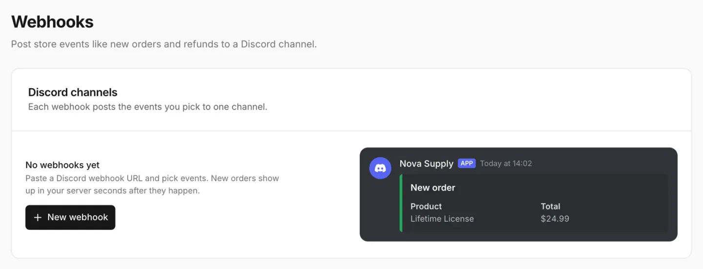
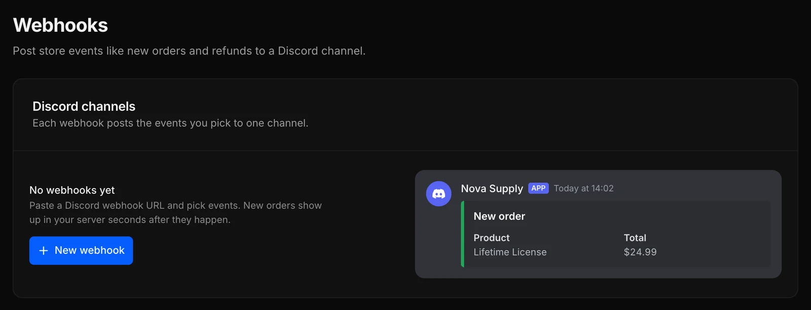

<Frame caption="Discord webhooks page in the dashboard (sample store).">
  
  
</Frame>

1. In Discord, open the channel settings. Under **Integrations** → **Webhooks**, create a webhook and copy its URL.
2. In Paysum, open **Integrations** → **Webhooks**. Add a webhook and paste the **Webhook URL**.
3. Choose the **Events** to post: **New order**, **Order completed**, **Order refunded**, **Order shipped**, **New product**, **New customer**, or **New review**.
4. Save the webhook.

Each webhook posts to one channel. Add a separate webhook for each channel. Keep the Discord webhook URL private.

## Check delivery

For example, select **New review** for a webhook that posts to your `#store-reviews` channel. Post a test review from your storefront, then check that the message appears in that channel. If it does not, check the selected event and confirm that the webhook still exists in Discord.

To receive signed checkout and withdrawal events on your own server instead, see [Webhooks](/webhooks).
