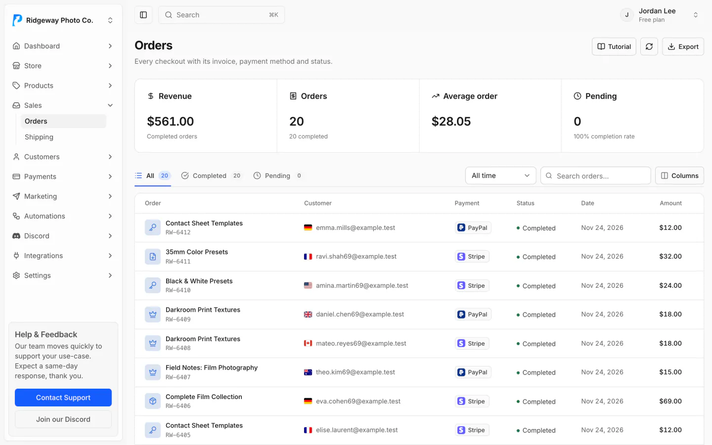
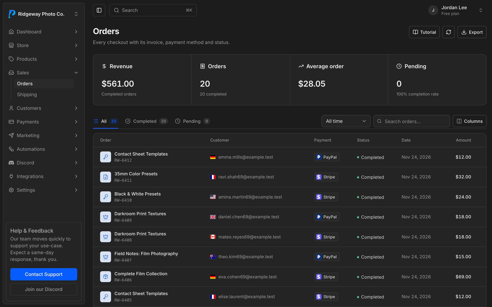

<Frame caption="The Orders page for a sample store.">
  
  
</Frame>

## Set it up

<Steps>
  <Step title="Find the order">
    Open Core → Orders and search using the order reference or buyer details.
  </Step>
  <Step title="Inspect the status">
    Distinguish an unpaid order from one awaiting confirmation or already completed. Check the matching provider transaction when needed.
  </Step>
  <Step title="Review the purchased items">
    Check the product, variant, quantity, buyer email, and delivery information saved with the order.
  </Step>
  <Step title="Handle the actual issue">
    For payment issues, verify the provider record. For delivery issues on a paid order, inspect product delivery and stock before resending goods.
  </Step>
</Steps>

## Keep useful references

An order reference and provider transaction reference are more useful than a screenshot of a return page. Include the time and timezone when reporting a transaction that cannot be found.

## Refunds and external providers

Check which refund actions are available for the specific order and payment method. A change to a platform order does not by itself prove that money has been refunded by an external provider.

## API checkout sessions

A checkout session is a customer’s payment opportunity; it is not automatically a completed order. Use session status and completed payment details to connect it to your own system.

## If something does not work

<Note title="What to check">
  Check the selected store and buyer email first. If an order is not completed, do not fulfill it solely because someone reached the success URL.
</Note>

Still stuck? [Contact support](https://docs.paysum.io/support) with the store, the page, and any order or request reference.

## Next steps

<CardGroup cols={2}>
  <Card title="How delivery works" href="https://docs.paysum.io/delivery" icon="Package">
    Choose how buyers receive a purchase and verify delivery after payment.
  </Card>
  <Card title="Payment methods" href="https://docs.paysum.io/payments" icon="CreditCard">
    Connect the accounts and wallets buyers use to pay your store.
  </Card>
  <Card title="Hosted checkout" href="https://docs.paysum.io/hosted-checkout" icon="CreditCard">
    Create a checkout from your server and send customers to the PaySum payment page.
  </Card>
  <Card title="Webhooks" href="https://docs.paysum.io/webhooks" icon="Webhook">
    Receive signed events when checkout sessions and withdrawals change state.
  </Card>
</CardGroup>
