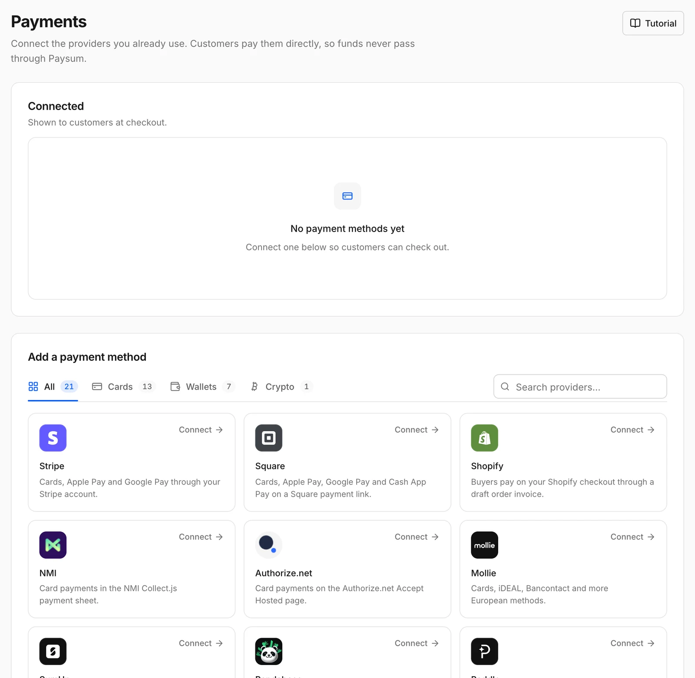
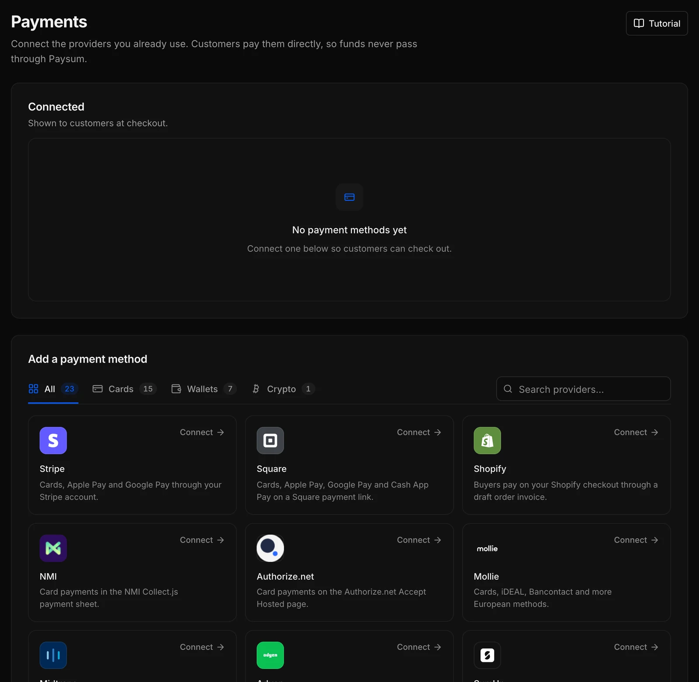

<Frame caption="Find and configure payment methods in the PaySum dashboard.">
  
  
</Frame>

## Set it up

<Steps>
  <Step title="Open payment settings">
    Choose the store, then go to Payments → Payment setup.
  </Step>
  <Step title="Configure a method">
    Select a provider and enter the credentials, account details, or destination requested by the setup screen.
  </Step>
  <Step title="Set method-specific rules">
    Review discounts, extra charges, and minimum amounts before enabling the method.
  </Step>
  <Step title="Save and test">
    Check a product checkout in a separate browser session. Confirm the correct account receives the payment and the order reaches the expected state.
  </Step>
</Steps>

## Which method to use

### Cards and commerce

<CardGroup cols={3}>
  <Card title="Stripe" href="/stripe" icon="/images/brands/stripe.svg" />
  <Card title="Square" href="/square" icon="/images/brands/square.svg" />
  <Card title="Shopify" href="/shopify" icon="/images/brands/shopify.svg" />
  <Card title="NMI" href="/nmi" icon="/images/brands/nmi.png" />
  <Card title="Authorize.net" href="/authorize-net" icon="/images/brands/authorizenet.png" />
  <Card title="Mollie" href="/mollie" icon="/images/brands/mollie.png" />
  <Card title="SumUp" href="/sumup" icon="/images/brands/sumup.svg" />
  <Card title="Pandabase" href="/pandabase" icon="/images/brands/pandabase.png" />
  <Card title="Paddle" href="/paddle" icon="/images/brands/paddle.svg" />
  <Card title="Lemon Squeezy" href="/lemonsqueezy" icon="/images/brands/lemonsqueezy.svg" />
  <Card title="Whop" href="/whop" icon="/images/brands/whop.svg" />
</CardGroup>

<Icon src="/images/brands/adyen.svg" size={20} /> **Adyen** and <Icon src="/images/brands/midtrans.svg" size={20} /> **Midtrans** are also available in **Payment setup**. Midtrans requires an IDR store currency.

See [Custom processor](/custom-processor) for other options.

### Wallets and alternative methods

<CardGroup cols={3}>
  <Card title="PayPal" href="/paypal" icon="/images/brands/paypal.svg" />
  <Card title="PayPal Friends & Family" href="/paypal" icon="/images/brands/paypal.svg" />
  <Card title="Cash App" href="/cash-app-and-venmo" icon="/images/brands/cashapp-glyph.svg" />
  <Card title="Venmo" href="/cash-app-and-venmo" icon="/images/brands/venmo-glyph.svg" />
  <Card title="Skinloop" href="/skinloop" icon="/images/brands/skinloop.png" />
  <Card title="OVGC" href="/ovgc" icon="/images/brands/ovgc.png" />
</CardGroup>

See [Customer balance](/customer-balance) for store credit.

### Crypto providers

<CardGroup cols={2}>
  <Card title="NOWPayments" href="/nowpayments" icon="/images/brands/nowpayments.png" />
  <Card title="Heleket" href="/heleket" icon="/images/brands/heleket.svg" />
  <Card title="Cryptomus" href="/cryptomus" icon="/images/brands/cryptomus.svg" />
  <Card title="Coinbase" href="/coinbase" icon="/images/brands/coinbase.svg" />
</CardGroup>

See [Crypto payments](/crypto-payments) for direct wallet payments and blockchain confirmations.

## Only enabled methods are shown

Checkout combines store settings with product and variant restrictions. Enabling a method at the store level does not guarantee it is available for every product.

## Keep credentials private

API secrets belong in the payment settings or your own backend. Do not paste provider secrets into product descriptions, custom pages, or an embed button.

## Different methods confirm differently

Card and PayPal providers report payment results through their integrations. Crypto orders may wait for blockchain confirmation. Cash App and Venmo require the configured receipt-verification flow.

## If something does not work

<Note title="What to check">
  If a method is missing, inspect its enabled state, required fields, product restrictions, and minimum order amount. If an order stays unpaid, inspect the provider’s actual transaction status rather than the browser return page.
</Note>

Still stuck? [Contact support](https://docs.paysum.io/support) with the store, the page, and any order or request reference.
