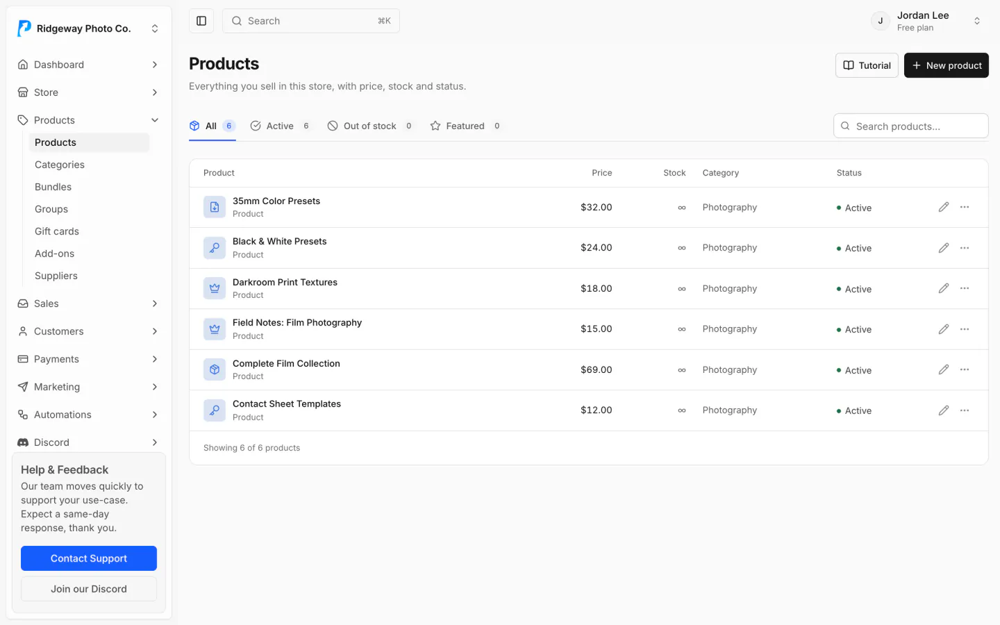
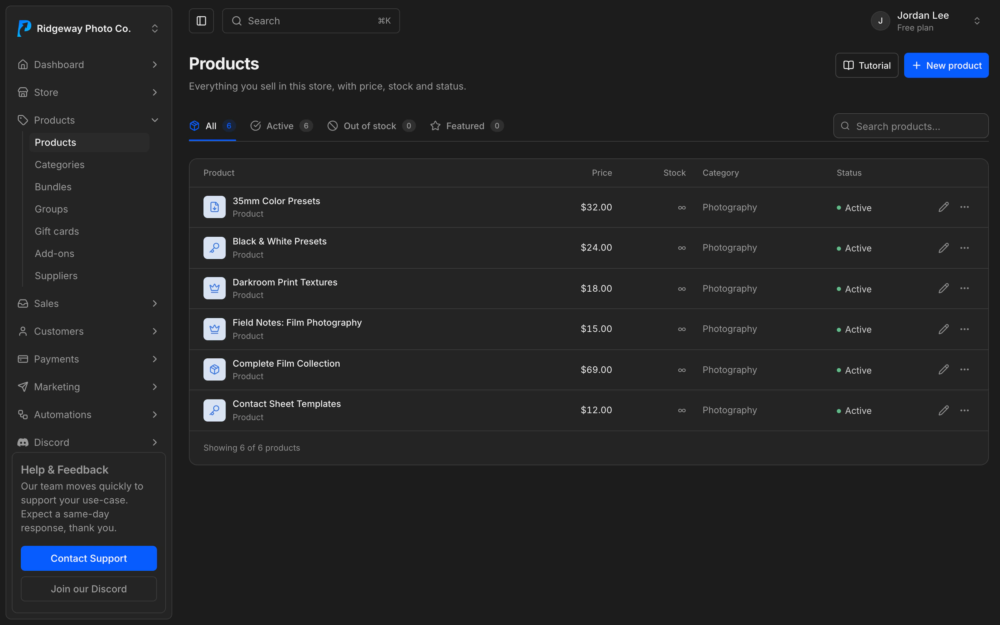

	Products are what customers buy. Paysum focuses on digital goods that can be delivered
	automatically after payment.

<Frame caption="The Products page for a sample photography store.">
  
  
</Frame>

## Delivery types

<Tabs>
	<Tab title="License keys">
		
Upload a list of keys as stock. Each order reserves and delivers the next available key.

	</Tab>
	<Tab title="Files">
		

			Attach a file that the customer can download from their delivery page once the payment clears.
		

	</Tab>
	<Tab title="Discord roles">
		
Connect your Discord server and grant a role to the buyer automatically.

	</Tab>
</Tabs>

## Variants and stock

	Products can have variants (for example durations or tiers), each with its own price and stock. When
	you create a checkout session with <code>product_ids</code>, stock is checked up front and the
	request fails with <code>insufficient_stock</code> if there isn’t enough.

## Organising your catalogue

	Group products into categories, sell them together as bundles, and run promotions with coupons and
	gift cards.

