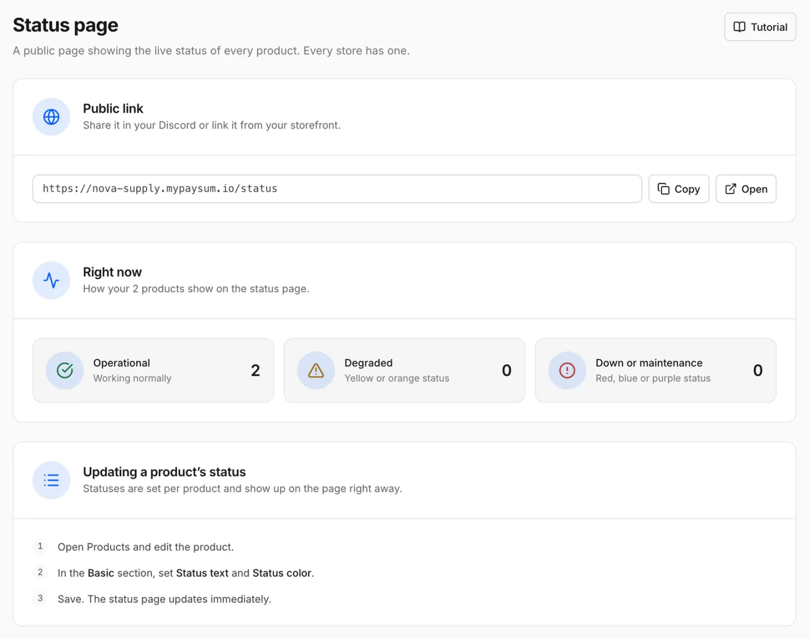
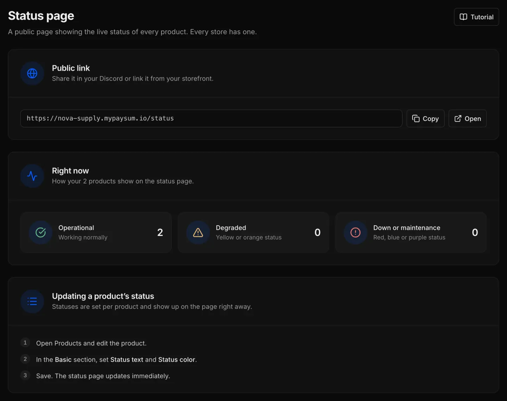

<Frame caption="Status page settings in the dashboard (sample store).">
  
  
</Frame>

Open **Store** → **Status page**. Under **Public link**, select **Copy** or **Open**. The page is at `https://yourstore.mypaysum.io/status`.

**Right now** shows the number of products in each group: **Operational**, **Degraded**, and **Down or maintenance**.

To change a status, edit the product. Set **Status text** and **Status color**, then save. The public page updates immediately.

For example, if buyers can place orders but delivery takes longer than usual, set the affected product to **Degraded** and use status text such as `Delivery delayed`. Open the **Public link** in a private browser tab to check what buyers see. When delivery returns to normal, update the product status again.
